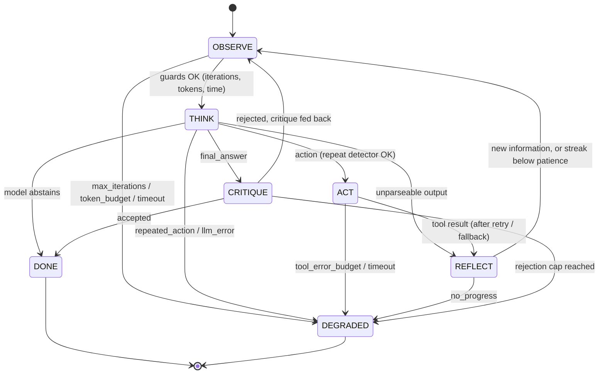

# react-planning-agent

[](https://github.com/Motssembillahmahin/react-planning-agent/actions/workflows/ci.yml)

A ReAct agent (observe → think → act → reflect) that provably terminates, critiques its own
answers, and degrades gracefully.

## The problem

The textbook ReAct loop — ask the model for a thought and an action, run the tool, append the
observation, repeat — has no stopping rule except "the model says it is done". In practice models
repeat the same tool call forever, spin on searches that return nothing, keep calling a tool that
is down, burn tokens, and confidently answer questions that the evidence never supported. This
project rebuilds the loop as an explicit state machine where every failure mode has a named,
independently switchable guard; where a critic must accept an answer before it is returned; and
where running out of budget produces a structured result (`success | partial | abstained |
failed`, best answer, the guard that tripped, reason, trace path) instead of an exception or a
hang. A deterministic evaluation with ablations measures what each piece is worth against a naive
baseline.

## The loop



Every transition is written to a JSONL trace (`traces/*.jsonl`); `react-agent replay` renders one.
The property test asserts that every recorded edge is one of the edges above.

## Termination guarantees

| Guarantee | Enforced by | Checked at | Default |
|---|---|---|---|
| At most `max_iterations` model calls for steps | `MaxIterationsGuard` (cannot be disabled) | before THINK | 12 |
| At most `max_critic_rejections` rejected answers, so critic calls are bounded too | rejection cap in CRITIQUE | CRITIQUE | 2 |
| Bounded token spend | `TokenBudgetGuard` | before THINK | 60,000 |
| Bounded wall-clock time | `TimeoutGuard` + per-attempt tool timeout | before THINK, after ACT | 120 s / 10 s |
| The same action (tool + normalised args) is not run in a loop | `RepeatedActionGuard` (sliding window) | before ACT | 3 within 6 |
| The agent does not spin without learning anything | `NoProgressGuard` (reflection novelty) | after REFLECT | 3 steps |
| A broken tool cannot consume the whole budget | `ToolErrorBudgetGuard` + retry cap + fallback | after ACT | 3 failures, 2 retries |
| `run()` never raises | catch-all → `failed` / `internal_error` result | everywhere | always |

Together: a run makes at most `max_iterations + max_critic_rejections` model calls, every tool call
is bounded by `(retries + 1) × timeout` (plus the fallback's), and the result is always a valid
`AgentResult`. `tests/test_property.py` checks this with Hypothesis over 300 random combinations of
model outputs (valid steps, garbage, conflicting fields), tool outcomes (ok, transient error, input
error, timeout, crash), configs, and critics. Breaking `MaxIterationsGuard` by one makes it fail.

## Results

`make eval` runs 36 tasks (10 solvable, 8 unsolvable, 8 loop-inducing, 10 tool-failure) against
five variants with `ScriptedLLM`. It is deterministic (CI checks the output is byte-identical) and
free. Full per-task table: [`evals/results.md`](evals/results.md).

<!-- results:start -->
| variant | termination rate | task success | correct abstention | mean iterations | mean tokens | safety-cap hits (loop tasks) |
|---|---|---|---|---|---|---|
| full | 100.0% | 94.4% | 87.5% | 2.83 | 708.8 | 0/8 |
| no_critic | 100.0% | 72.2% | 25.0% | 2.53 | 621.1 | 0/8 |
| no_repeat_detector | 100.0% | 94.4% | 87.5% | 2.94 | 742.3 | 0/8 |
| no_progress_detector | 100.0% | 94.4% | 87.5% | 3.33 | 927.3 | 0/8 |
| naive | 80.6% | 44.4% | 25.0% | 11.69 | 11038.7 | 7/8 |
<!-- results:end -->

What the numbers say:

- **Guards make termination unconditional.** The naive baseline hits its 50-step safety cap on 7
  of 8 loop-inducing tasks; the eighth (`loop-same-answer`) "terminates" by returning an
  unsupported answer. Every guarded variant stops on its own on all 36 tasks.
- **The critic is the biggest single contributor.** Removing it drops task success from 94.4% to
  72.2% and correct abstention from 87.5% to 25.0%: without it the agent returns invented numbers
  on unsolvable tasks and the first, premature answer on solvable ones.
- **The two loop detectors overlap on this task set.** Removing either leaves success unchanged
  because the other catches the loop, but it costs more: +0.11 mean iterations without the repeat
  detector, +0.50 without the no-progress detector (two tasks run to `max_iterations`).
- **The full agent fails 2 tasks by design.** Both are critic blind spots (see Limitations).

## Quickstart

Requires [uv](https://docs.astral.sh/uv/). The Makefile is the only interface.

```bash
make install     # uv sync (Python 3.12, dev tools)
make lint        # ruff check + ruff format --check
make typecheck   # mypy --strict on src/react_agent
make test        # pytest + hypothesis, fails under 90% coverage
make eval        # deterministic eval → evals/results.md, evals/results.json
make demo        # scripted run: premature answer → critic rejects → calculator → accepted
```

Run on your own task with a real model (keys are read from environment variables only):

```bash
uv sync --extra anthropic                       # or --extra openai
export ANTHROPIC_API_KEY=...                    # or OPENAI_API_KEY / OPENAI_BASE_URL
uv run react-agent run "How many years passed between the Eiffel Tower and Apollo 11?"
uv run react-agent run "..." --provider ollama --model llama3.1   # local, via Ollama
uv run react-agent replay traces/run-<timestamp>.jsonl
make eval-real                                  # live-provider eval; skipped if no key is set
```

`AnthropicLLM` defaults to `claude-opus-5` and enables server-side refusal fallbacks
(`refusal_fallbacks=False` turns them off). `make eval-real` costs money and is never run in CI.

## Add a tool

A tool is a name, a description, a pydantic model for its arguments, and a function from that
model to text. Raise `ToolInputError` for bad input (never retried) and `ToolError` (or anything
else) for transient failures (retried with backoff, then the fallback, then recorded).

```python
from pydantic import BaseModel
from react_agent.tools import Tool, ToolInputError, default_registry


class WordCountArgs(BaseModel):
    text: str


def word_count(args: WordCountArgs) -> str:
    if not args.text.strip():
        raise ToolInputError("text is empty")
    return str(len(args.text.split()))


registry = default_registry()
registry.register(
    Tool(
        name="word_count",
        description="Count words in a text.",
        args_model=WordCountArgs,
        fn=word_count,
    ),
    fallback=None,  # or the name of another registered tool with compatible args
)
```

Pass `registry` to `ReActAgent(llm, registry, config)`. The tool's signature is added to the
system prompt automatically. To use it in the eval, add a factory to `_BASE_FACTORIES` in
`src/react_agent/evaluation.py` and reference it from `evals/tasks.yaml` (where you can also wrap
it in `flaky`, `always_fail`, `slow`, or `misleading`).

## Layout

```
src/react_agent/
  agent.py        ReActAgent state machine (OBSERVE/THINK/ACT/REFLECT/CRITIQUE/DONE/DEGRADED)
  guards.py       termination guards + action fingerprinting
  critic.py       EvidenceCritic (default), LLMCritic, CompositeCritic
  baseline.py     NaiveReActAgent (50-step safety cap, nothing else)
  tools/          calculator (AST, no eval), units, search over data/corpus.json, fact store,
                  executor (retry/backoff/timeout/fallback), fault-injection wrappers
  llm/            LLM protocol, ScriptedLLM, AnthropicLLM, OpenAICompatibleLLM, parsing
  evaluation.py   harness, metrics, ablations, report writer
  cli.py          react-agent run / replay
evals/tasks.yaml  36 scripted tasks
```

## Limitations

- **The eval measures the control loop, not intelligence.** `ScriptedLLM` replays fixed outputs
  and never reacts to what it observes. That is what makes the numbers reproducible, but it also
  flatters the naive baseline. On 3 tool-failure tasks (`fail-flaky-retry`,
  `fail-flaky-fallback`, `fail-always-fallback`) its only tool call fails, yet its script still
  returns the right answer and is scored as a success. On `fail-misleading-units` it ignores the
  tool's (wrong) 233 °F and is credited for 212 °F. It succeeds on the 2 slow-tool tasks for real,
  because it has no timeout and simply waits. No live-model numbers are claimed here.
- **The critic checks grounding, not truth.** `fail-misleading-search`: the search tool returns
  910 m for the Burj Khalifa (true value 828 m) and the critic accepts the grounded wrong answer.
  `unsolv-neptune-sqrt`: the model feeds a remembered number into the calculator, so the answer
  is "grounded" in a tool output whose input was invented. Both are counted as failures.
- **The critic's heuristics are crude.** Numbers match up to the answer's own precision, so
  "about 11" is accepted for 10.687. Words use suffix-stripping and a 50% overlap threshold, so a
  correct but heavily paraphrased answer can be rejected, and an answer that reuses evidence words
  in a false statement can be accepted. `LLMCritic`/`CompositeCritic` exist for live models but
  are not evaluated here.
- **Reflection is lexical.** "New information" means unseen words or numbers in a successful
  observation, minus echoes of the action's own arguments. A tool that returns fresh but
  irrelevant text resets the no-progress streak.
- **The task set does not separate the two loop detectors.** Each catches every loop the other
  catches, so the ablation shows only cost differences. Distinguishing them needs tasks where the
  same action legitimately returns new data, or different actions return identical data.
- **Time bounds are not preemptive.** Guards run between steps, so one step can overrun
  `timeout_s` by up to one LLM call plus `(retries + 1) × tool_timeout` per tool. Timed-out tool
  threads cannot be killed in Python; they finish in the background. A hung provider call is
  bounded only by the SDK client timeout (120 s by default).
- **Token counts in the scripted eval are estimates** (about 4 characters per token).
- **The provider classes are unit-tested only with fake clients.** They have never been run
  against a live API in this repo, including the Anthropic refusal-fallback beta parameter.
- **Small, self-authored benchmark.** 36 tasks, one seed per flaky tool, written by the same
  author as the agent, so they share its assumptions about what a failure looks like.
- **No sandboxing or prompt-injection defence** for user-added tools or tool outputs.

## Project docs

[`vision.md`](vision.md) (what this proves and does not), [`state.md`](state.md) (build log and
decisions), [`CLAUDE.md`](CLAUDE.md) / [`AGENTS.md`](AGENTS.md) (conventions for agents),
[`checks.md`](checks.md) (acceptance checks).

## License

MIT
